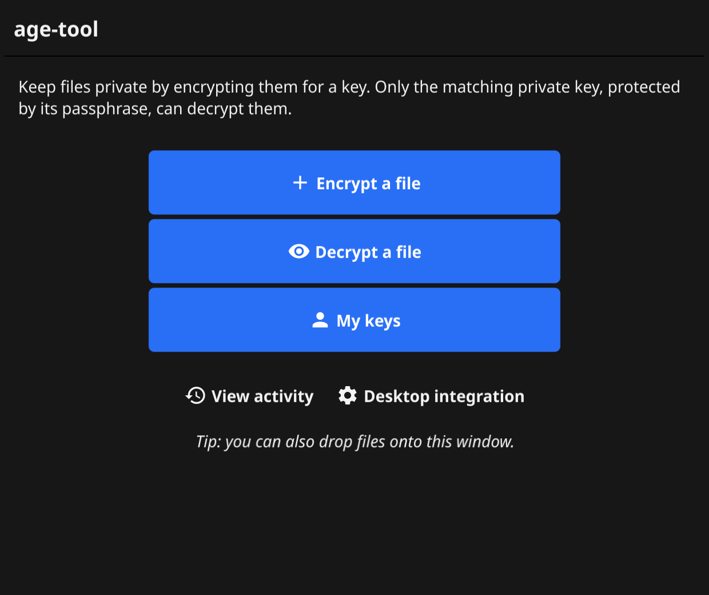

# age-tool

Encrypt and decrypt files with [age](https://age-encryption.org) keys, generate and manage key pairs, and keep an audit trail. Built with the [filippo.io/age](https://filippo.io/age) Go library.

age-tool comes in two forms, sharing the same keys and the same security rules:

- **Desktop app** for Linux: no terminal needed, with right-click **Encrypt** / **Decrypt** in the file manager. Aimed at non-technical users.
- **Command-line tool** for macOS, Linux and Windows: an interactive menu in the terminal.

Upgrading from 1.x? Keys now live in a key store instead of the current folder. See [Upgrading to 2.0](docs/upgrading-to-2.0.md).

## Contents

- [Quick start](#quick-start)
- [Desktop app guide](#desktop-app-guide)
- [Command-line guide](#command-line-guide)
- [Where files are kept](#where-files-are-kept)
- [Building from source](#building-from-source)
- [Security](#security)
- [License](#license)

## Quick start

### Desktop app (Linux)

1. Download **`age-tool-linux-x64.AppImage`** (most PCs) or **`age-tool-linux-arm64.AppImage`** (ARM) from the [latest release](https://github.com/anveitch/age-tool/releases/latest).
2. Make it executable: in Files, right-click → **Properties** → **Executable as Program**, or run `chmod +x age-tool-linux-x64.AppImage`.
3. Double-click it, and choose **Add to desktop** when asked.
4. Choose **My keys** → **Create a key**, then encrypt and decrypt from the home screen or by right-clicking files.

Needs Ubuntu 22.04 or newer, or a similar distribution (glibc 2.34+: Debian 12, Linux Mint 21, Fedora 36 and later). The [user guide](docs/user-guide.md) walks through everything with screenshots.

### Command line

**Homebrew (macOS):**

    brew tap anveitch/age-tool
    brew install age-tool

**Manual:** download the binary for your platform from the [latest release](https://github.com/anveitch/age-tool/releases/latest), make it executable and put it on your PATH:

    chmod +x age-tool-macos-arm64
    mv age-tool-macos-arm64 /usr/local/bin/age-tool

| Platform | Binary |
|---|---|
| macOS Apple Silicon | `age-tool-macos-arm64` |
| macOS Intel | `age-tool-macos-intel` |
| Windows x64 | `age-tool-windows-x64.exe` |
| Linux x64 | `age-tool-linux-x64` |
| Linux ARM64 | `age-tool-linux-arm64` |

Then run `age-tool` in the folder holding the files you want to encrypt or decrypt, and choose **Key Management** → **Generate New Key Pair** to make your first key.

The command-line binaries are static and self-contained, with nothing else to install.

### Verifying downloads

Every release includes `SHA256SUMS`, listing the SHA256 hash of every file. Download it into the same folder as your file, then run:

    sha256sum -c SHA256SUMS --ignore-missing      # Linux
    shasum -a 256 -c SHA256SUMS --ignore-missing  # macOS

Each downloaded file should report `OK`.

## Desktop app guide

The [user guide](docs/user-guide.md) is written for non-technical users and covers installing, creating a key, encrypting, decrypting, sharing your public key, adding contacts, backing up keys and troubleshooting.



### Desktop integration

On first start from an AppImage, the app offers to add itself to the desktop, for the current user only. **Desktop integration** on the home screen installs, updates or removes it later. It adds:

- an app menu entry, with the app icon
- a `.age` file type with its own icon, opened by age-tool on double-click
- right-click **Encrypt with age-tool** / **Decrypt with age-tool** entries in Files (GNOME, under **Scripts**), Dolphin (KDE), Nemo (Cinnamon) and Thunar (XFCE)

The entries point at the AppImage's current location. If the AppImage is moved or replaced by a download elsewhere, the app notices and offers to update them. Everything is written under `~/.local/share` (plus Thunar's `~/.config/Thunar/uca.xml`, where existing custom actions are kept), and **Remove** takes it all away again.

### Command-line options

The desktop app also takes arguments, which the menu entries use:

    age-tool-linux-x64.AppImage                     Open age-tool
    age-tool-linux-x64.AppImage encrypt <file>...   Encrypt files
    age-tool-linux-x64.AppImage decrypt <file>...   Decrypt .age files
    age-tool-linux-x64.AppImage <file>...           Decrypt .age files, or encrypt other files
    age-tool-linux-x64.AppImage --install-desktop   Add the desktop integration
    age-tool-linux-x64.AppImage --remove-desktop    Remove it again
    age-tool-linux-x64.AppImage --version           Show the version

## Command-line guide

### Usage

Run age-tool from the folder containing the files to encrypt or decrypt:

    age-tool

Keys come from your [key store](#where-files-are-kept), so age-tool works from any folder.

    1) Encrypt
    2) Decrypt
    3) Key Management
    4) Quit

Type `q` or `Q` at any time to quit instead of selecting option 4.

Options:

    --keys <folder>  Use the key files in <folder> instead of your key store
                     (--keys . gives the age-tool 1.x behaviour)
    --version        Show the version
    --help           Show this help, including your key store and log paths

### Encryption

1. The tool lists all files in the current folder (excluding `.age` files) for selection.
2. The tool lists the public keys in your key store: your own and your contacts'.
   - Keys with nicknames are displayed as `Nickname (filename.pub)`.
   - Keys without nicknames are displayed as `filename.pub`.
3. The selected file is encrypted for the chosen public key.
4. The output has `.age` appended to the original file name. For example, `document.txt` becomes `document.txt.age`.

### Decryption

1. The tool lists all `.age` files in the current folder for selection.
2. The tool lists the private keys (`.priv`) in your key store.
3. The selected private key must be passphrase-protected. Unprotected private keys are rejected with a warning.
4. Enter the passphrase for the key (input is hidden). You have 3 attempts.
5. The file is decrypted, and the output has the `.age` extension removed. For example, `document.txt.age` becomes `document.txt`.

The private key is unlocked entirely in memory. It is never written to disk unprotected, and its in-memory copy is zeroed once parsed.

### Key Management

    1) List Keys
    2) Generate New Key Pair
    3) Encrypt a Private Key
    4) Delete a Key Pair
    5) Nickname a Key
    6) Import a Public Key (someone else's)
    7) Export / Share a Public Key
    8) Back

**List Keys** shows the key store's keys grouped by name. Each private key shows its protection status:

    key1
      Public:  Work Laptop (key1.pub)
      Private: Work Laptop (key1.priv) [ENCRYPTED]
    key2
      Public:  key2.pub
      Private: key2.priv [OPEN]

- `[ENCRYPTED]`: the private key is passphrase-protected and ready to use.
- `[OPEN]`: the private key is unprotected and will be rejected during decryption.

**Generate New Key Pair** creates a new age X25519 key pair with mandatory passphrase protection:

1. Prompts for a name (e.g. `work` creates `work.pub` and `work.priv`).
2. Prompts for a passphrase of at least 12 characters, and confirmation (input is hidden).
3. Generates the key pair in memory.
4. Writes the public key to `name.pub`.
5. Encrypts the private key with the passphrase and writes it to `name.priv`.

The unprotected private key is never written to disk.

**Encrypt a Private Key** protects an existing unprotected `.priv` file (for example, one made with `age-keygen`) with a passphrase, in place.

**Delete a Key Pair** deletes a key's `.pub` and `.priv` files (or whichever exists) after confirmation, and removes their nicknames.

**Nickname a Key** gives any `.pub` or `.priv` file a readable nickname, shown wherever keys are listed. Each file is nicknamed separately. Nicknames are stored in `keys.json` beside the keys:

```json
{
  "work.priv": "Work Laptop",
  "work.pub": "Work Public"
}
```

**Import a Public Key** adds someone else's public key (a contact), so you can encrypt files for them. Load it from a `.pub` file, or paste the `age1…` string. A pasted private key is refused without being echoed back.

**Export / Share a Public Key** shows a public key's `age1…` string to send to others, and can save a copy as a file. It never overwrites an existing file.

### Startup checks

On every launch, the tool:

- offers to import 1.x key files found in the current folder into the key store (see [Upgrading to 2.0](docs/upgrading-to-2.0.md))
- warns about unprotected private keys in the key folder:

      !! WARNING: Unencrypted private key(s) detected !!
         - key2.priv
      These keys are NOT passphrase-protected and cannot be used for decryption.
      Use Key Management > Encrypt a Private Key to secure them.

- offers to fix private keys that other users can read (to `0600`)
- offers to remove leftover partial output files in the current folder from a session that was killed mid-operation

### Transaction logging

Every encryption, decryption and key creation is logged, by the command-line tool and the desktop app alike, in two places:

- **Central log**, in your [log folder](#where-files-are-kept), recording full file paths. The desktop app's **View activity** reads it.
- **Local log** in the folder of the file that was encrypted or decrypted (for key creation, the key folder), in the same format as 1.x:
  - `age-tool.log`: one human-readable line per transaction
  - `logs/`: one JSON receipt per transaction, named by type and time (e.g. `encrypt-2026-04-09-143022.json`)

What is recorded:

- **Encrypt:** date and time; source file with MD5 and SHA256 hashes; output file (`.age`) with hashes; public key file and nickname.
- **Decrypt:** date and time; source file (`.age`) with hashes; output file with hashes; private key file and nickname.
- **Key creation:** date and time; key name; public and private key files with hashes; a note that the private key is passphrase-protected.

Logs contain no passphrases or key material.

### Manual key generation

To make keys with the [age](https://github.com/FiloSottile/age) tools instead:

    age-keygen -o key1.txt                 # make a key pair
    age-keygen -y key1.txt > key1.pub      # extract the public key
    age -p -o key1.priv key1.txt           # protect the private key with a passphrase
    rm key1.txt                            # remove the unprotected copy

Then copy `key1.pub` and `key1.priv` into your key store (or use `--keys` with their folder). The built-in **Generate New Key Pair** is safer, because it never writes an unprotected key to disk.

## Where files are kept

| Data | Linux | macOS | Windows |
|---|---|---|---|
| Key store (`.pub`, `.priv`, `keys.json`) | `~/.local/share/age-tool/keys/` | `~/Library/Application Support/age-tool/keys/` | `%AppData%\age-tool\keys\` |
| Settings | `~/.config/age-tool/` | `~/Library/Application Support/age-tool/` | `%AppData%\age-tool\` |
| Central audit log | `~/.local/state/age-tool/` | `~/Library/Logs/age-tool/` | `%LocalAppData%\age-tool\logs\` |

On Linux, `$XDG_DATA_HOME`, `$XDG_CONFIG_HOME` and `$XDG_STATE_HOME` are used when set. The key store folder is owner-only (`0700`), and so are the files in it (`0600`).

**Back up your key store.** Files encrypted for your key can only be decrypted with your private key and its passphrase.

## Building from source

Requires [Go](https://go.dev/) 1.26.11 or later. An older Go (1.21 or later) downloads the required toolchain automatically.

Command-line tool for your current platform:

    go build -o age-tool .

Desktop app for your current platform (needs a C compiler and, on Linux, the OpenGL, X11 and Wayland development packages; see [packaging/linux/Dockerfile](packaging/linux/Dockerfile) for the list):

    go build -o age-tool-gui ./cmd/age-tool-gui

Everything for release:

    ./build.sh              # CLI for all 5 platforms, both AppImages, SHA256SUMS
    ./build.sh --cli-only   # CLI only, without Docker

This writes to `builds/`. CLI builds are static (CGO disabled), with local paths trimmed and debug symbols stripped. The AppImages are built in Docker on Ubuntu 22.04 by [packaging/linux/build-gui.sh](packaging/linux/build-gui.sh), so Docker must be running. The same source always gives the same AppImage.

Tests:

    go test ./...

`release.sh` makes a release: it runs the vulnerability scans, sets the version, builds everything, tags, and publishes the GitHub release. Versions like `2.0.0-rc.1` are published as pre-releases, and Homebrew is only updated for full releases.

## Security

The desktop app and the command-line tool share one core package, so they enforce the same rules.

### Input sanitisation

- **Path traversal prevention.** Key names and file names containing `../`, absolute paths or path separators are rejected.
- **Key validation.** Public keys are parsed and validated as age public keys before use, and private keys are checked to be passphrase-protected before decryption is attempted.
- **Input length limits.** Names and nicknames are limited to 255 characters.
- **Whitespace stripping.** Inputs are trimmed of leading and trailing whitespace.

### File handling

- **File size limit.** Files larger than 2 GB are rejected before processing.
- **Restrictive permissions.** Output files, key files, `keys.json` and logs are written owner-only (`0600`), and age-tool's folders `0700`.
- **Atomic output.** Output is written to a hidden temporary file (`.age-tool-partial-*`) and only renamed to its final name once the operation succeeds. A corrupt or truncated `.age` file never leaves partial plaintext behind, and never damages an existing file of the same name.
- **Interrupt handling.** If interrupted (Ctrl+C, SIGTERM, SIGHUP, or closing the app window mid-operation), any partial output is removed. The command-line tool also restores the terminal, so an interrupted passphrase prompt doesn't leave input hidden.
- **Overwrite confirmation.** If an output file already exists, age-tool asks before replacing it.

### Passphrase security

- **Minimum length.** Passphrases must be at least 12 characters when creating or protecting keys.
- **Weak passphrase detection.** Passphrases of one repeated character, only digits, or common patterns are flagged. The desktop app shows a strength meter.
- **Attempt limit.** Decryption allows 3 passphrase attempts.
- **Memory clearing.** Passphrases and the decrypted private key text are zeroed after use.

### Private key handling

- **Passphrase-protected keys only.** Unprotected private keys are never used for decryption, and are flagged at startup.
- **In-memory unlocking.** No unprotected private key material is written to disk during key generation, key protection or decryption.
- **Never shared.** Sharing exports only the public key. A private key pasted as a contact is refused without being shown.
- **Permission checks.** Private keys readable by other users are found at startup. The command-line tool offers to fix them; the desktop app fixes them.

### Audit log security

- **Restrictive permissions.** Logs and receipts are owner-only (`0600`), in `0700` folders.
- **No sensitive data.** Passphrases and key material are never logged. Logs contain only file names, paths, hashes, timestamps and nicknames.

### Release security

- **Vulnerability scanning.** Releases are blocked on any `govulncheck` finding, for the code as built and for every required module.
- **Checksums.** Every release file is listed in `SHA256SUMS`.
- **Pinned build inputs.** The AppImage build verifies the Go download and the AppImage runtime against fixed hashes.

### Best practices

- **Never commit `.priv` files to version control**, even protected ones.
- **Use the built-in key generation**, which never writes unprotected key material to disk.
- **Public keys (`.pub`) and encrypted files (`.age`) are safe to share.** Only the matching private key can decrypt.
- **Back up your key store.** A lost private key or forgotten passphrase can't be recovered.
- **`keys.json` contains only nicknames**, not key material.

## License

This project is released under the MIT License. See the [LICENSE](LICENSE) file for details.
